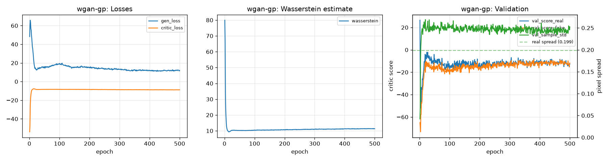
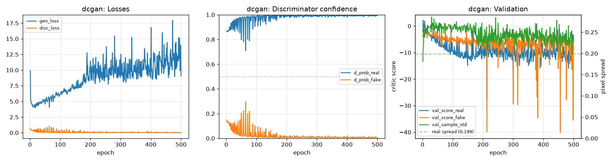
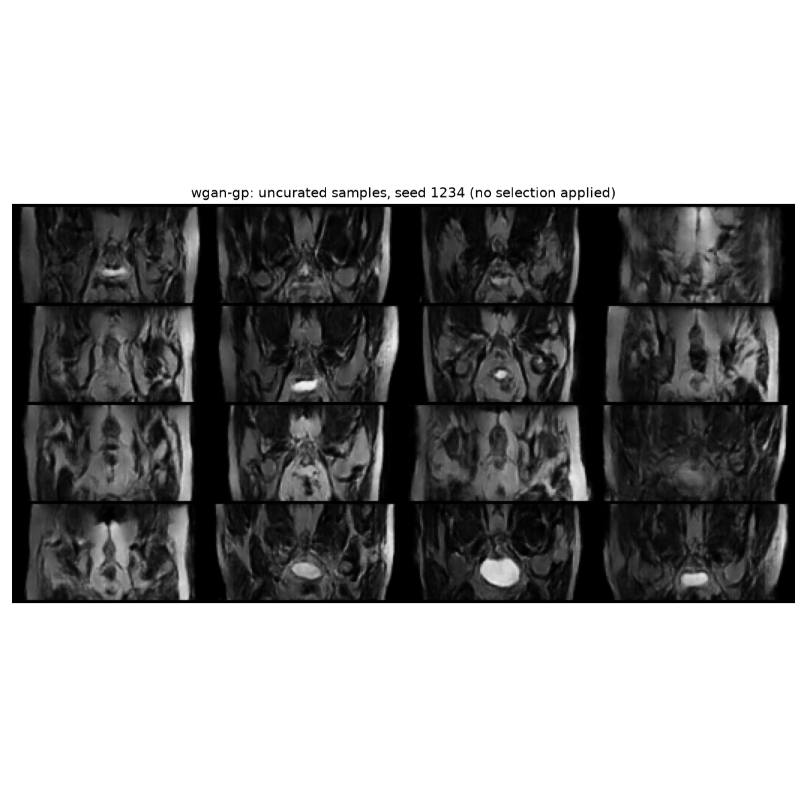
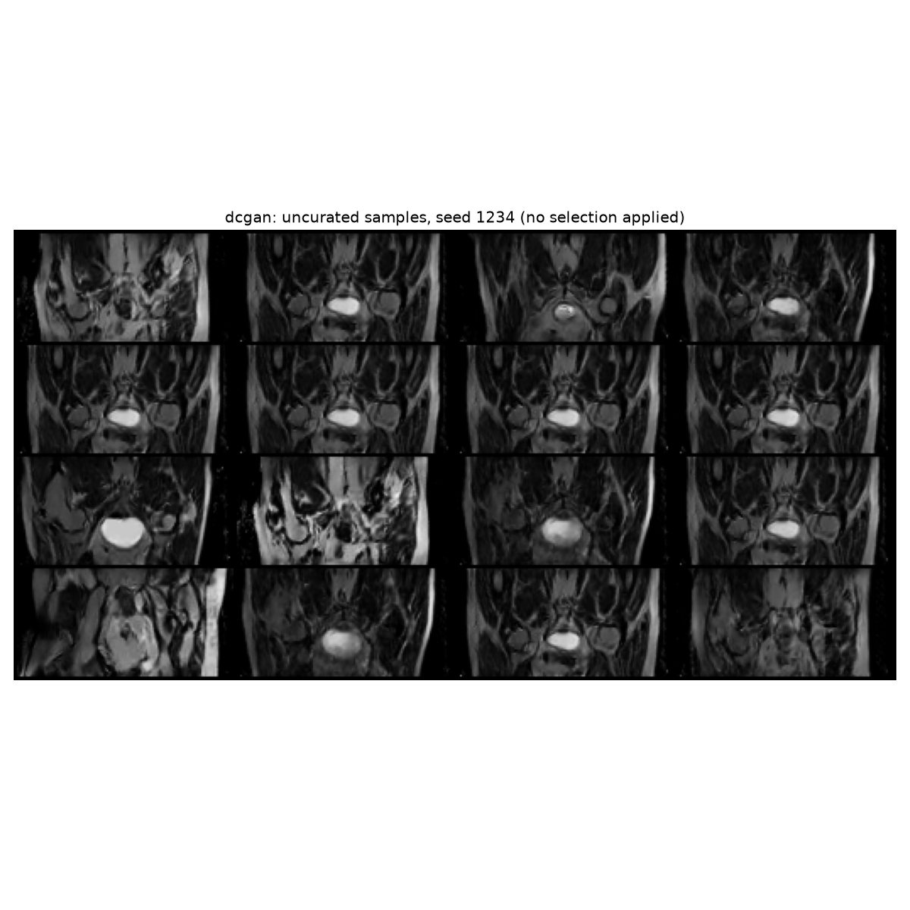
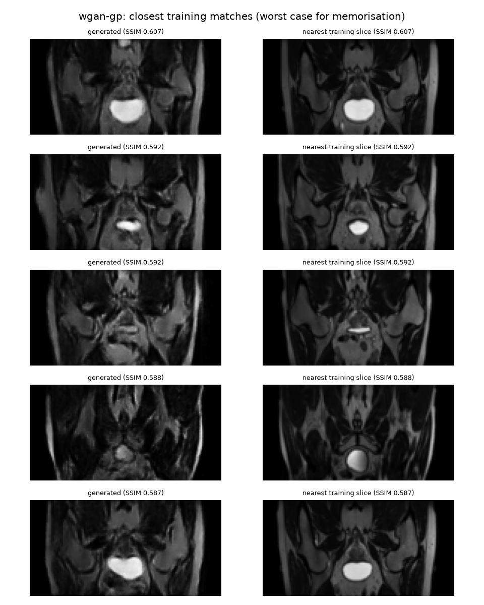
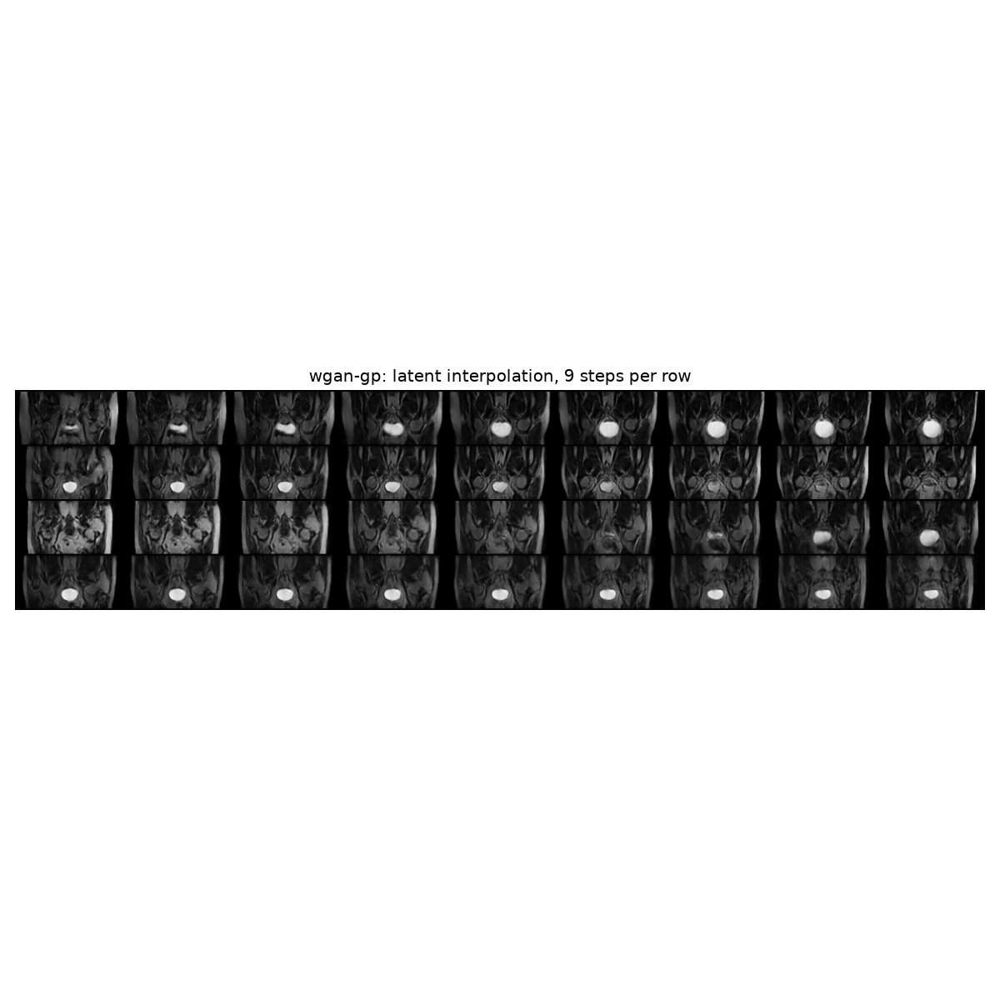
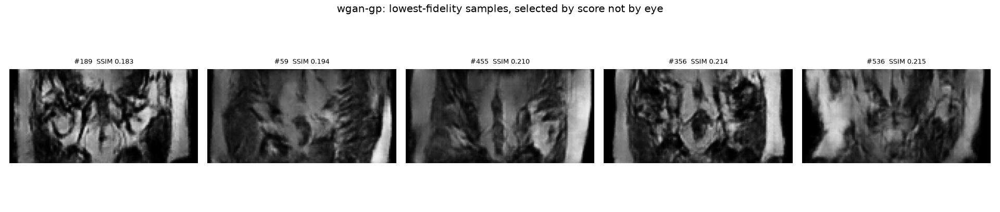

# WGAN-GP Medical Slice Imagery Generation

## Problem and Approach

Medical imaging research is limited less by modelling capability than by access to
data. Patient scans are protected by privacy law, and the cohorts that exist are
small. A generative model offers a way out: if synthetic scans are realistic
enough to train downstream models on, and genuinely novel rather than copies of
real patients, they can be shared between institutions without exposing anyone.

That "if" is the whole problem, and it is a three-way trade-off. A generator can
fail by producing blurred or collapsed output that teaches a downstream model
nothing; by hallucinating tissue boundaries that do not occur in real anatomy,
which teaches it something actively harmful; or by memorising its training set,
in which case sharing the synthetic cohort is a confidentiality breach wearing a
disguise. Optimising hard for realism pushes a model toward the third failure.

This project trains a **WGAN-GP** on 2D coronal pelvic MRI slices from the HipMRI
study and measures where it lands on that trade-off, against a **DCGAN** baseline
trained on identical data with an identical generator.

## How It Works

A GAN trains two networks against each other. The **generator** maps a 128-value
random vector to a 64x128 image. The **critic** scores images, and the generator
is rewarded for producing output the critic scores highly. Neither network is
told what anatomy is; the structure emerges from the competition.

The two models here differ only in how that competition is scored, which is what
makes the comparison meaningful.

**DCGAN** uses a discriminator that classifies images as real or fake and is
trained with binary cross-entropy. Its weakness is saturation: once the
discriminator is confident, its gradient flattens and the generator stops
receiving a useful learning signal, exactly when it most needs one.

**WGAN-GP** replaces the classifier with a critic that emits an unbounded score.
What matters is the gap between its mean score on real and generated batches,
which estimates the Wasserstein distance between the two distributions. An
unbounded score cannot saturate, so the gradient survives. The estimate is only
valid while the critic is 1-Lipschitz - its output cannot change faster than its
input - which is enforced by a **gradient penalty**: the critic is punished for
gradient norms away from 1 at points interpolated between real and generated
images. Because that penalty is defined per sample, the critic uses layer
normalisation rather than batch normalisation, which would make each output
depend on the rest of the batch. The critic is updated five times per generator
update, since the distance estimate is only meaningful when the critic is close
to optimal.

```text
  HipMRI slice (.nii.gz)                     z ~ N(0, I), 128 values
  256x128, patient-disjoint splits                    |
              |                                       v
              v                     +----------- Generator (shared) -----------+
  dataset.py                        | ConvT 4x8 kernel  ->  512 x  4 x   8     |
    crop/pad to 256x128             | ConvT stride 2    ->  256 x  8 x  16     |
    per-slice scale to [-1, 1]      | ConvT stride 2    ->  128 x 16 x  32     |
    antialiased resize to 64x128    | ConvT stride 2    ->   64 x 32 x  64     |
              |                     | ConvT stride 2    ->    1 x 64 x 128     |
              |                     | (BatchNorm + ReLU between, tanh output)  |
              |                     +------------------------------------------+
              |                                       |
              | real 1 x 64 x 128                     | fake 1 x 64 x 128
              +-------------------+-------------------+
                                  |
                                  v
         +--------------------------+--------------------------+
         | WGAN-GP critic           | DCGAN discriminator      |
         |  4 stride-2 convs        |  4 stride-2 convs        |
         |  LayerNorm, LeakyReLU    |  BatchNorm, LeakyReLU    |
         |  -> unbounded score      |  -> real/fake logit      |
         +--------------------------+--------------------------+
         | E[fake] - E[real]        | BCE with logits          |
         |   + 10 x grad penalty    |   (non-saturating G)     |
         | 5 critic steps / G step  | 1 D step / G step        |
         | Adam 1e-4, (0.0, 0.9)    | Adam 2e-4, (0.5, 0.999)  |
         +--------------------------+--------------------------+
                                  |
                                  | gradients flow back to the generator
                                  v
  predict.py: trained generator -> 1,000 uncurated samples
    AC1  SSIM to nearest test slice, FID      AC3  nearest training slice
    AC2  pairwise SSIM vs real                AC4  VRAM, throughput
```

*The generator is shared by both models: a 128-d latent vector is projected to a
4x8 feature map, then doubled four times to 64x128 with a tanh output. Only the
second network and the loss differ between WGAN-GP and DCGAN.*


## Feasibility Review

*As presented and accepted at the in person review  Two plans changed
after the review: training moved from Rangpur to a local RTX 3060 Ti (suggested by
the tutor for easy developement), and slices are resized to 64x128 rather than 128x128.*

### 1. User Need, Scope & Acceptance Criteria

#### Intended User & Purpose
- **User:** a medical imaging research team that needs more MRI training data than patient privacy laws and limited scans allow.
- **Purpose:** generate pelvic MRI slice imagery that can augment downstream model training and be shared between centres without exposing real patients. This has value because synthetic slices are only useful if they are realistic (so downstream models learn true anatomy), diverse (model doesn't collapse to same output each time) and novel (no memorised, and therefore anonymised and unlinked, patient scans).

#### Scope & Acceptance Criteria
- **In scope:** unconditional 2D slice generation from HipMRI data; WGAN-GP vs a DCGAN baseline
- **AC1 – Fidelity:** mean SSIM > 0.6 between generated slices and their closest real test slice, and FID lower than the DCGAN baseline.
- **AC2 – Diversity:** mean SSIM between pairs of generated slices is no higher than between real slices.
- **AC3 – No memorisation:** Max SSIM ≤ 0.95 between a generated slice and the most similar-appearing training data entry
- **AC4 – Resources:** training fits in ≤ 16 GB peak VRAM within ≤ 6 GPU-hours on Rangpur; 1,000 slices generate in < 10 s. Secondary benchmark: train and generate within 30 min on an Apple M4 (16 GB).

### 2. Model Choice & Course Concepts

#### Dataset Configuration
- MR images only (no masks) from the provided train/validate/test folders; the case IDs in the filenames are checked so each patient sits in a single split.
- The GAN trains on the train split only; the test split is the reference set for SSIM/FID and the memorisation control.
- Slices are resized to a fixed size (128×128, to confirm in the data audit) and scaled to [-1, 1] to match the generator's tanh output.

#### Model Architecture & Difficulty
- **Model:** WGAN-GP [Normal difficulty]. Convolutional generator (128-d latent → upsampling blocks → squash with tanh) and critic (strided convs, layer norm, no batch norm, unbounded linear output).
- **Training:** 5 critic steps per generator step, gradient penalty λ = 10.
- **Baseline:** DCGAN with the same backbone, using batch norm and BCE loss, so the comparison isolates the effect of the Wasserstein loss.

#### Supporting Concepts & Literature
- GANs and DCGAN (Radford et al., 2016); Wasserstein distance and the Lipschitz critic (Arjovsky et al., 2017); gradient penalty (Gulrajani et al., 2017).
- Evaluation: SSIM (Wang et al., 2004), FID (Heusel et al., 2017), and nearest-neighbour memorisation audits with latent interpolation.

### 3. Preliminary Feasibility Evidence
#### Data Audit
- Slices per split: [train / validate / test]; patients per split: [ ]; native image size(s): [ ]; intensity range: [ ].
- Patient overlap between splits: [none found / details].

#### Baseline Smoke Test
- DCGAN trained on MNIST for [ ] epochs, then on a HipMRI subset for [ ] epochs: [losses stable? outputs show pelvic outline?].

#### Resource Estimate
- Parameters: generator, critic; peak VRAM at batch: x GB; time per epoch: x s on GPU and CPU.

### 4. Risks, Budget & Fallback
#### Key Risks
- Training instability or mode collapse (most likely in the DCGAN baseline).
- Memorisation: the dataset comes from a small number of patients, and neighbouring slices from one patient look alike.
- How SSIM against sample slices should be computed is ambiguous in the spec
- Rangpur queue delays.

#### Compute Budget
- ~10 GPU-hours on Rangpur in total (baseline + WGAN-GP + evaluation); development and debugging done on my machine in subsets.

#### Next Planned Experiment
- Train the DCGAN baseline on the full train split, then WGAN-GP with the same backbone, logging losses, SSIM and FID every few epochs.

#### Fallback Plan
- If 128×128 is unstable or too slow, drop to 64×64. If the SSIM target is missed I'll report the gap with the failure analysis.

## Dependencies
Developed on Omarchy (Arch Linux) with Python 3.14.7.

All versions are pinned in [`requirements.txt`](requirements.txt).

| Package | Version | Used for |
|---|---|---|
| Python | 3.14.7 | Interpreter (pinned in `.python-version`) |
| torch | 2.14.1 | Models and training |
| torchvision | 0.29.1 | Image transforms and sample grids |
| numpy | 2.5.4 | Data loading and visualisation (not used in `modules.py`) |
| nibabel | 5.4.2 | Reading HipMRI Nifti slices |
| scipy | 1.18.1 | Required for FID |
| torchmetrics | 1.9.0 | SSIM and FID |
| torch-fidelity | 0.4.0 | Inception feature extractor for FID |
| matplotlib | 3.11.2 | Loss plots and figures |
| tqdm | 4.70.1 | Progress bars |

### Hardware
- Training and evaluation: NVIDIA RTX 3060 Ti, Linux (Arch). The card is sold as 8 GB, but PyTorch reports **7.63 GB** usable.
- NVIDIA driver 610.57.04, CUDA 13.0, compute capability 8.6.

### Setup

The interpreter version is pinned in `.python-version`, so `uv`
creates the environment without needing a matching system Python:

```bash
uv venv .venv
source .venv/bin/activate
uv pip install -r requirements.txt
python -c "import torch; print(torch.cuda.is_available())"
```

If you already have Python 3.14 installed and would rather not use `uv`:

```bash
python -m venv .venv
source .venv/bin/activate
pip install -r requirements.txt
```

On Linux the PyPI `torch` wheel already includes CUDA, so only the NVIDIA driver is needed.

*Setup instructions written by Claude*

## Usage

The dataset is never committed. Download `keras_slices_data` and keep it outside
the repository, then point the scripts at it with the `--data-root` argument (`--root` for `dataset.py`). The folder must
contain `keras_slices_train`, `keras_slices_validate` and `keras_slices_test`.

All commands below assume the virtual environment is active and are run from
`recognition/s4808331-ImageGen/`.

```bash
source .venv/bin/activate
# Example path only: point this at your own copy of keras_slices_data
export DATA=~/Projects/Comp3710/keras_slices_data
```

### 1. Check the data pipeline

Verifies that no patient appears in more than one split, reports the slice and
patient counts for each split, and writes a grid of preprocessed real slices so
the preprocessing can be inspected by eye.

```bash
python dataset.py --root $DATA --out outputs/real_samples.png
```

Expected output:

```
train:    11460 slices | 31 patients | 191 sessions | shape (1, 64, 128) | range [-1.00, 1.00]
validate:   660 slices |  4 patients |  11 sessions | shape (1, 64, 128) | range [-1.00, 0.94]
test:       540 slices |  3 patients |   9 sessions | shape (1, 64, 128) | range [-1.00, 0.95]
```

### 2. Check the models

Builds both model pairs, runs a batch of noise through them and asserts the
output shapes, the `tanh` range and the absence of batch normalisation in the
critic. Prints the parameter counts used in the resource table.

```bash
python modules.py
```

### 3. Train

The two models are trained separately. Run them one at a time: training both at
once makes the VRAM and timing measurements meaningless.

```bash
# WGAN-GP
python train.py --model wgan-gp --epochs 100 --data-root $DATA

# DCGAN baseline
python train.py --model dcgan --epochs 100 --data-root $DATA
```

A short run with fewer epochs is worth doing first to confirm the outputs all land where expected:

```bash
python train.py --model wgan-gp --epochs 2 --data-root $DATA
```

The first run of either model preprocesses the dataset once and caches it to `outputs/cache/`; later runs load the cache directly.

### 4. Resume or extend a run

Feature implemented by Claude Opus 5.5

`--epochs` is the target epoch to stop at, not a number of extra epochs, so the
command below continues a finished 100-epoch run through to epoch 400. Weights,
both optimiser states, the epoch counter and the logged history are all
restored, and the curves span the whole run rather than restarting.

```bash
python train.py --model wgan-gp --epochs 400 --resume --data-root $DATA
```

### Outputs

Each run writes to `outputs/<model>/`:

| Path | Contents |
|---|---|
| `history.json` | every logged metric, per epoch, plus the run config |
| `training_curves.png` | losses, Wasserstein estimate (or discriminator confidence), validation |
| `samples/epoch_NNNN.png` | uncurated 16-image grid from a fixed seed, one per epoch |
| `checkpoints/last.pt` | rewritten every epoch, used by `--resume` |
| `checkpoints/epoch_NNNN.pt` | kept every `--checkpoint-every` epochs |

The per-epoch sample grids all use the same latent vectors, so viewing them in
order shows the generator improving rather than a fresh random draw each time.
`outputs/` is ignored by git; figures for this report are copied into `assets/`.

### Useful options

| Option | Default | Notes |
|---|---|---|
| `--model` | `wgan-gp` | `wgan-gp` or `dcgan`; selects the loss, optimiser settings and head |
| `--epochs` | 100 | target epoch to stop at |
| `--batch-size` | 64 | 128 also fits comfortably |
| `--n-critic` | 5 (1 for DCGAN) | critic steps per generator step |
| `--gp-lambda` | 10 | gradient penalty weight |
| `--upsample` | `transpose` | `nearest` avoids checkerboard artifacts |
| `--critic-norm` | `layer` | `layer`, `instance` or `none`; batch norm is deliberately not offered |
| `--resume` | off | continue from `checkpoints/last.pt` |
| `--out-dir` | `outputs` | use a separate directory to keep experiments apart |

Run `python train.py --help` for the full list.

### Measured cost

On an RTX 3060 Ti at the default batch size of 64, WGAN-GP runs at roughly
9-12 seconds/epoch with a peak allocation of 1.12 GB, so a 100-epoch run takes about
17 minutes. DCGAN is faster per epoch, having no gradient penalty and one generator pass.

### 5. Evaluate

`predict.py` loads a trained generator from its checkpoint, generates uncurated
samples and runs every acceptance-criterion measurement (AC1-AC4). The critic
and discriminator are not loaded, as they are only needed for training.

```bash
# Both models, plus a side-by-side comparison table
python predict.py --model both --data-root $DATA

# One model, from a specific checkpoint
python predict.py --model wgan-gp --checkpoint outputs/wgan-gp/checkpoints/epoch_0500.pt --data-root $DATA
```

By default each model's checkpoint is `outputs/<model>/checkpoints/last.pt`. With
`--model both`, `--checkpoint` is ignored and each model's `last.pt` is used. A
pass/fail summary for each acceptance criterion is printed when a model finishes.

Each evaluation writes to `outputs/evaluation/<model>/`:

| Path | Contents |
|---|---|
| `report.json` | every measured metric, including the real-data controls |
| `samples_seed_NNNN.png` | uncurated 16-image grids from three fixed seeds |
| `latent_interpolation.png` | four rows walking between pairs of latent vectors |
| `nearest_neighbours.png` | the five generated slices closest to a training slice, beside that slice |
| `failure_autopsy.png` | the five lowest-fidelity samples, selected by SSIM score |
| `embedding.png` | 2D PCA projection of real and generated slices |

`--model both` also writes `outputs/evaluation/comparison.md`, the WGAN-GP vs
DCGAN table used in the Results section.

| Option | Default | Notes |
|---|---|---|
| `--model` | `wgan-gp` | `wgan-gp`, `dcgan` or `both` |
| `--checkpoint` | `outputs/<model>/checkpoints/last.pt` | generator weights to evaluate |
| `--n-samples` | 1000 | samples used for SSIM, diversity and the memorisation audit |
| `--n-fid-samples` | 2048 | separate, larger sample for FID |
| `--n-diversity` | 400 | subsample size for pairwise SSIM |
| `--prefilter-k` | 50 | L2 shortlist size for the nearest-neighbour SSIM search |
| `--seed` | 1234 | seed for every generated sample |
| `--out-dir` | `outputs/evaluation` | where reports and figures are written |

*Usage section drafted by Claude Opus 5.5*

## Preprocessing and Data Splits

### Splits

The HipMRI 2D data ships pre-split into `keras_slices_train`,
`keras_slices_validate` and `keras_slices_test`. An audit of the case IDs
embedded in every filename confirmed these splits are **patient-disjoint**:

| Split | Slices | Patients | Scan sessions |
|---|---|---|---|
| train | 11,460 | 31 | 191 |
| validate | 660 | 4 | 11 |
| test | 540 | 3 | 9 |

No patient ID appears in more than one split. `dataset.check_patient_leakage()`
asserts this at the start of every training run and raises rather than warns,
because the assumption silently ceasing to hold would invalidate every metric in
this report.

Patient-level separation matters more here than slice counts suggest. The 31
training patients produced 191 separate scan sessions, and neighbouring slices
within one session are near-duplicates - measured SSIM between adjacent slices of
one session is 0.91. A single patient spanning two splits would mean the model
being evaluated on anatomy it had already seen, and would make the memorisation
audit meaningless.

The GAN trains on the train split only. The test split is the reference set for
fidelity and FID; the validate split provides per-epoch health metrics during
training and the real-data control for AC1.

### Preprocessing

Slices are loaded with nibabel, with a guard that drops the trailing singleton
dimension some HipMRI files carry (see project specification Appendix B).

**Geometry.** The audit found slices are 256x128, which display as a
perfectly 2:1 landscape image. Sizes below are given as height x width. The original plan
was to resize to 128x128, but squashing to square would compress the pelvis by a
factor of two along one axis and produce anatomy that is physiologically
impossible by construction, which is precisely the failure this project exists to
detect. Slices are therefore resized to 64x128, an exact 2x downsample that
preserves geometry and costs half the pixels of a 128x128 square. Resizing uses
antialiasing: without it, discarded fine texture aliases into high-frequency
speckle that the critic can trivially detect and the generator cannot reproduce.

As a guardrail, any slice that does not match the common 256x128 grid is centre-cropped or padded onto it before resizing, so it keeps the
same physical scale as every other slice rather than being stretched relative to them.

**Intensity.** MRI has no absolute brightness scale, and the audit found
per-slice maxima varying by roughly 5x across the dataset. Normalisation is therefore **per slice** - a single global
scale would wash out some slices and clip others. Each slice is rescaled to
[-1, 1] to match the generator's tanh output; real and generated images must
occupy the same range or the critic learns to separate them on scale alone.

**Augmentation.** None is applied. Horizontal flipping is superficially
attractive given the approximate left-right symmetry of pelvic anatomy, but it is
not anatomically free - situs anomalies exist and organ asymmetry is real - and
with 11,460 training slices the data budget did not require it. Declining to
augment also keeps the memorisation audit clean: every generated slice is
compared against the actual training images, not against transformed variants.

## Results

> **Note:** figures below are drawn from the evaluation run at 500 epochs for both
> models. Numbers should be refreshed after any re-run.

### Training behaviour

| | WGAN-GP | DCGAN |
|---|---|---|
| Epochs | 500 | 500 |
| Generator steps | 17,500 | 89,500 |
| Head (critic/discriminator) steps | 89,500 | 89,500 |
| Wall-clock | ~84 min | 62 min |
| Peak VRAM during training | 1.12 GB | 1.06 GB |

Both models see identical data and take identical numbers of head updates. They
differ in generator updates because WGAN-GP takes a critic step on every batch
but a generator step on only every fifth. This is reported explicitly because it is the single largest
confound in any epoch-matched GAN comparison.




WGAN-GP trained without any instability events. The Wasserstein estimate
fell from 79.9 to a plateau of ~10 by epoch 15 and stayed there for the
remaining 485 epochs; the gradient penalty settled at approximately 0.19,
confirming the Lipschitz constraint held throughout.

A finding worth stating plainly: **the Wasserstein plateau did not indicate
convergence.** Sample quality continued improving visibly from epoch 25 through
to epoch 500, long after the curve flattened. The estimate is a
measurement between two networks improving together, so it settles at an
equilibrium while absolute quality still rises. Stopping on the curve would have
discarded most of the model's development. This is a concrete illustration of why
GANs lack a usable convergence criterion, and why the sample grids rather than
the loss curves governed the stopping decision.

**DCGAN's discriminator saturated.** Confidence drifted from 0.88/0.12 at epoch
10 to 0.992/0.008 over the final hundred epochs, with several occilations
 before settling. Generator loss rose from 4.3 to 10-17 and grew noisier:
the generator was being pushed harder while receiving a weaker signal.

**Held-out score inversions.** On the validate split, the discriminator scored
unseen real slices as *more fake* than its own generator's output in **412 of 500
epochs**. The WGAN-GP critic did this **0 times in 500 epochs**. The baseline's
discriminator learned to recognise its training set rather than to recognise
realism - a memorisation signal in the adversarial signal itself.

### Sample quality




*Uncurated grids from fixed seeds. Every image drawn is shown*.

### Acceptance criteria

| Metric | WGAN-GP | DCGAN | Criterion |
|---|---|---|---|
| AC1 mean SSIM to nearest real test slice | **0.3474** | 0.3019 | > 0.6 |
| AC1 real-data SSIM ceiling (control) | TODO | TODO| - |
| AC1 FID vs test (n=540) | **119.36** | 140.16 | below baseline |
| AC1 FID vs train (n=11,460) | **85.64** | 122.27 | below baseline |
| AC2 pairwise SSIM, generated | **0.2345** | 0.3188 | <= real |
| AC2 pairwise SSIM, real | 0.2555 | 0.2555 | - |
| AC3 max SSIM to training slice | 0.6073 | **0.4456** | <= 0.95 |
| AC3 same statistic, real test control | 0.5268 | 0.5268 | - |
| AC4 generator parameters | 4,852,609 | 4,852,609 | - |
| AC4 generation throughput | 14,547 img/s | 15,388 img/s | 1000 in < 10 s |

**AC1 - fidelity. Comparative criterion met; absolute threshold not met.** WGAN-GP's
FID is lower than the baseline's on both reference sets, by 30% against the larger
train reference, so the comparative half of AC1 passes decisively.

The absolute SSIM > 0.6 threshold was not met by either model, and the measured
evidence indicates **it is not reachable on this dataset without memorisation.**
Real held-out slices score only 0.360 mean and 0.461 max against real training
slices. The cause is that SSIM compares fixed pixel positions with no alignment
search, and these slices are not spatially registered: shifting one slice by two
pixels against itself drops SSIM from 1.00 to 0.38. Scoring above 0.6 therefore
requires near-pixel-exact reproduction of a reference slice - which AC3 exists to
forbid. AC1 and AC3 are in direct tension, and the honest report of WGAN-GP's
0.3474 is that it reaches approximately 97% of the level unseen anatomy
achieves.

**AC2 - diversity. WGAN-GP passes, DCGAN fails.** Generated slices from WGAN-GP
are less similar to one another (0.2345) than real slices are to one another
(0.2555). DCGAN's are *more* similar (0.3188), indicating partial structural mode
collapse. Notably, the per-epoch pixel-spread metric logged during training showed
no collapse for DCGAN; pairwise SSIM caught a loss of structural variety that
pixel variance did not. This connects the discriminator saturation above to a
measurable downstream consequence.

**AC3 - memorisation. Both pass; the margins differ in kind.**



Neither model approaches the 0.95 threshold. Read against the real-data control
rather than the threshold, WGAN-GP's mean (0.4291) is close to
the control (0.422): **on average its output is as original
as genuinely unseen patient data.** Its maximum (0.6073) does exceed the control
maximum (0.5268), so the closest single match sits nearer the training set than
any real held-out slice does. Inspection of those pairs shows shared pose,
framing and bladder position - the dataset's consistent acquisition geometry -
with clearly different underlying anatomy. That is learned acquisition convention,
not a copied patient.

DCGAN's lower maximum (0.4456) should not be read as better patient privacy. It sits
further from the training set partly because it sits further from everything:
its fidelity is lower across the board. Reduced memorisation purchased with
reduced quality is not a favourable trade.



Latent interpolation corroborates AC3. Walking between latent vectors produces
smooth, continuous deformation - the bladder growing and shrinking gradually,
tissue boundaries moving coherently - with no abrupt transitions or implausible
intermediate frames. A generator that had memorised a set of training images
would jump between them. The learned mapping is continuous, which is what a
genuine anatomical model looks like and what a lookup table does not.

**AC4 - resources.** Both generators are architecturally identical
(~4.8 million parameters), so inference cost is the same by construction. Training
peak VRAM was 1.12 GB (WGAN-GP) against 1.06 GB (DCGAN), both far inside the
7.63 GB PyTorch reports as usable on the RTX 3060 Ti. Generation of 1,000 slices completes in well under
a second against the 10-second budget. WGAN-GP's additional cost is wall-clock:
matching the baseline's generator-step count takes roughly five times as long,
because of the 5:1 critic schedule and the second backward pass the gradient
penalty requires.

## Failure Autopsy



The five cases below are the **lowest-fidelity samples by SSIM**, selected
programmatically rather than by eye, so the selection is reproducible and cannot
be accused of flattering the model.

1. **Sample 189 (SSIM 0.183)** - low clarity, internal structures seem completely inaccurate and irrelevant, poor symmetry
2. **Sample 59 (SSIM 0.194)** - smeared low resolution shapes, no clearly identifiable structures, poor symmetry
3. **Sample 455 (SSIM 0.210)** - same as #2, also has slightly identifiable gridline/square artifacts. Brightness changes left to right. Potential effect of transposed convolutions
4. **Sample 356 (SSIM 0.214)** - less of a brightness gradient but still with seemingly inaccurate dark splotches
5. **Sample 536 (SSIM 0.215)** - washed out, soft tissue edges, no recognisable structures, poor symmetry

All five successfully showed the torso body outline, but struggled with unclear internal structures and artifacts.

## Recommendation

**To the project manager: the WGAN-GP cohort is suitable for downstream
augmentation, with conditions. It is not yet suitable for unrestricted release.**

The evidence supporting release is substantive. The generated distribution is at
least as diverse as the real one (AC2), average novelty is close to that of
genuinely unseen patient data (AC3), latent interpolation is smooth and
continuous, and no generated slice approaches the memorisation threshold. The
model trained stably across 500 epochs without a single instability event, and
its critic showed no sign of overfitting to the training split.

Three conditions qualify that verdict.

**First, fidelity is passable but not high.** FID of 85.6 against the training
reference is well ahead of the baseline, but the samples are recognisably
synthetic: tissue margins are softer than real acquisitions and fine texture is
not faithfully reproduced. These slices are suitable for augmenting a real
training set, not for replacing one, and they should not be used for any task
depending on fine-grained texture.

**Second, the evidence base is thin.** The training set comprises only 31 patients.
Diversity and novelty are measured relative to that selection, and nothing in this
evaluation establishes that the model extends to anatomy different from
theirs. Any claim about coverage is bounded by those patients.

**Third, the memorisation audit should be re-run before any external release.**
The maximum generated-to-training similarity exceeds the real-data control. The
inspected cases are explicable as shared acquisition geometry rather than copying,
but that conclusion rests on visual inspection of a handful of pairs. A release
decision warrants a systematic audit across a larger sample.

**The baseline should not be used.** Beyond losing on fidelity and failing the
diversity criterion, its discriminator scored unseen real data as more fake than
its own output in 82% of training epochs - it learned to recognise its training
set rather than realism. That is a memorisation signature in the training
process, and it is the specific failure mode that makes generated medical data
unsafe to share.

**Recommended next steps before release:** train at higher resolution to improve
image fidelity; expand the number of patients; re-run the memorisation audit at
scale; and have a radiologist assess the generated output.

## References

1. A. Radford, L. Metz, and S. Chintala, "Unsupervised representation learning
   with deep convolutional generative adversarial networks," in *Proc. ICLR*, 2016.
2. M. Arjovsky, S. Chintala, and L. Bottou, "Wasserstein generative adversarial
   networks," in *Proc. ICML*, 2017, pp. 214-223.
3. I. Gulrajani, F. Ahmed, M. Arjovsky, V. Dumoulin, and A. Courville, "Improved
   training of Wasserstein GANs," in *Proc. NeurIPS*, 2017.
4. Z. Wang, A. C. Bovik, H. R. Sheikh, and E. P. Simoncelli, "Image quality
   assessment: from error visibility to structural similarity," *IEEE Trans.
   Image Processing*, vol. 13, no. 4, pp. 600-612, 2004.
5. M. Heusel, H. Ramsauer, T. Unterthiner, B. Nessler, and S. Hochreiter, "GANs
   trained by a two time-scale update rule converge to a local Nash equilibrium,"
   in *Proc. NeurIPS*, 2017.
6. A. Odena, V. Dumoulin, and C. Olah, "Deconvolution and checkerboard artifacts,"
   *Distill*, 2016.

## Artificial Intelligence Usage Disclosure

Claude (Claude Opus 5.5) was used throughout this project to streamline and educate me during development

**Used for:**

- **Code scaffolding and implementation.** Claude drafted the structure and much
  of the implementation of `dataset.py`, `modules.py`, `train.py` and
  `predict.py`, including the gradient penalty, both training loops, the SSIM
  nearest-neighbour search and the evaluation metrics. I reviewed, edited and
  committed all of it, and corrected the code where it was wrong.
- **Data audit.** Claude ran the initial audit that established slice counts,
  patient-level split separation and the 256x128 geometry
- **Design recommendations.** Verified my idea to do the 64x128 resize over 128x128, and suggested per-slice
  intensity normalisation. `GroupNorm` in place of batch normalisation in the
  critic, and the decision to record both generator and head step counts were all
  recommended by Claude with stated reasoning. I accepted or modified each.
- **Diagnosis and debugging.** Claude identified the discriminator saturation and
  held-out score inversion in the DCGAN logs, the unreliability of the L2
  prefilter in the nearest-neighbour search, a VRAM measurement artifact, and a
  duplicate epoch entry produced by the resume logic.
- **Explanation.** I used Claude extensively to understand GAN concepts and other necessary theory
  (Wasserstein distance, the Lipschitz constraint, normalisation variants, latent
  space, and the behaviour of SSIM), which informed the analysis in this report.
- **Report drafting.** Claude drafted sections of this README, such as the pipeline diagram and the Usage section. It also suggested n_critic = 5, λ = 10 and the later scrapped Apple M4 benchmark from the feasibility review; the goal of running on my own hardware was mine. Everything written or suggested was reviewed and edited by me.

**Not used for:**

- Unchecked code generation; everything generated or edited was inspected and tested by me.
- Running training or evaluation; all runs were executed and supervised by me.
- Committing to the repository; every commit is mine.
- Producing results: All numbers in this report are measured outputs from the code in this directory.

Components with **heavy AI usage** are marked inline in the source files where Claude
authored, reworte or scaffolded a method or class.
